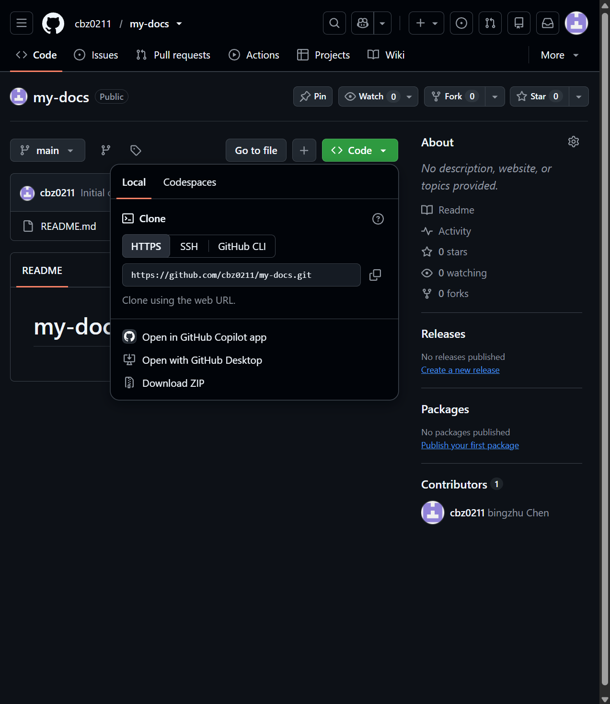
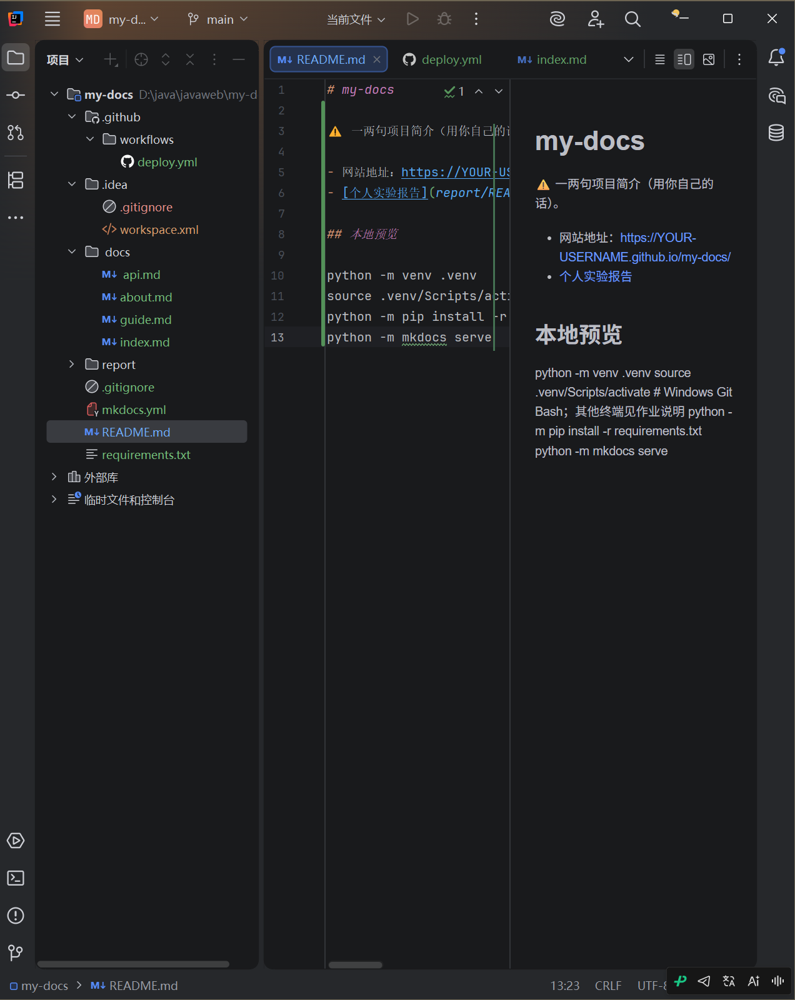
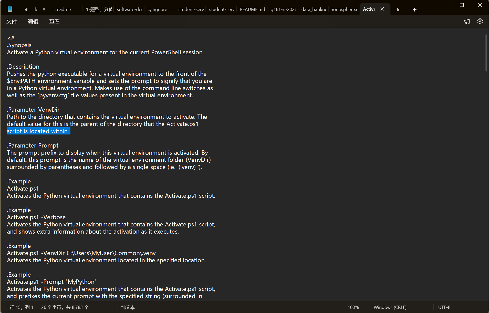
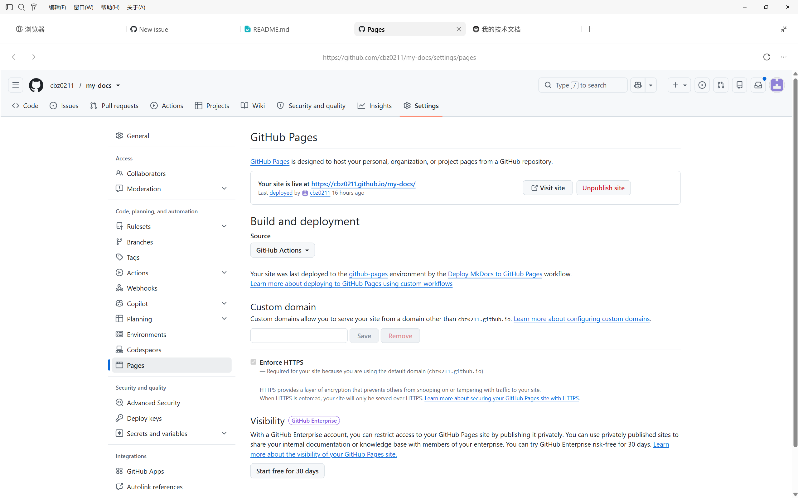
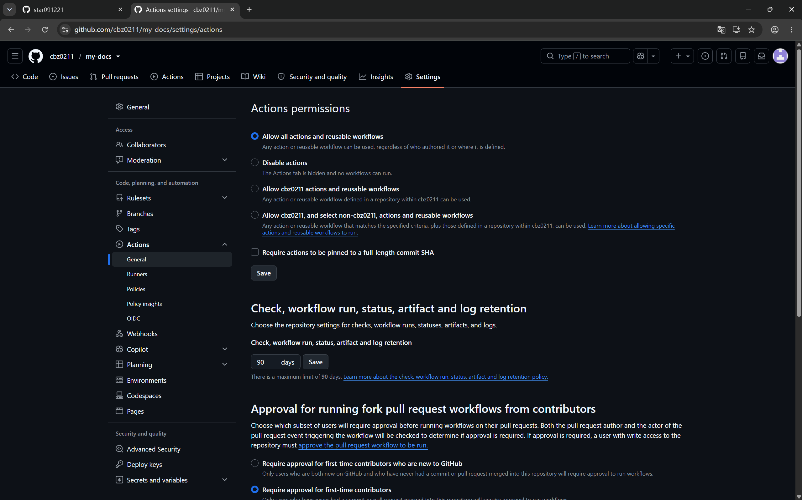
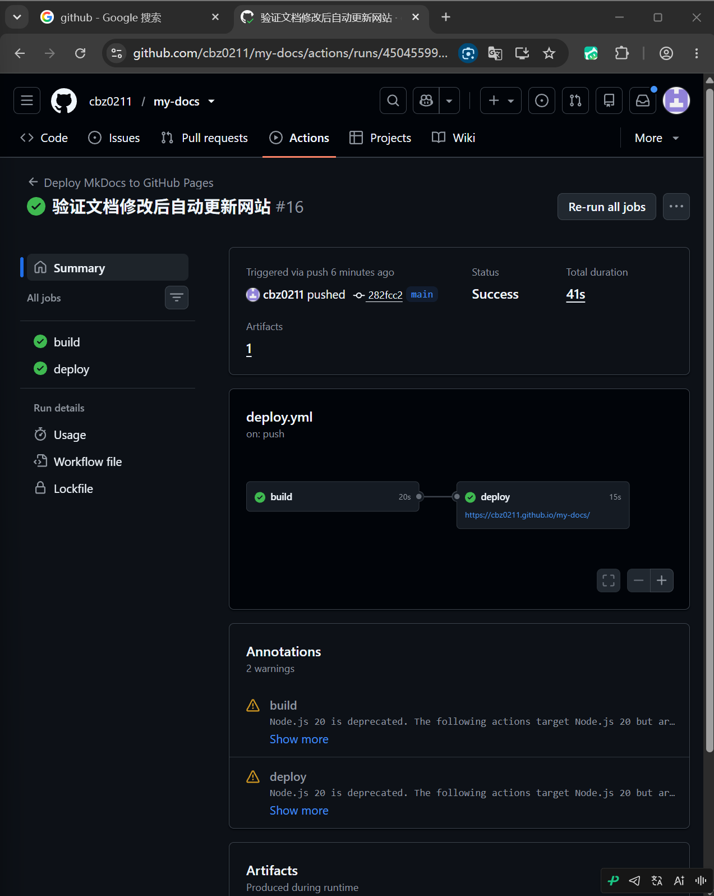
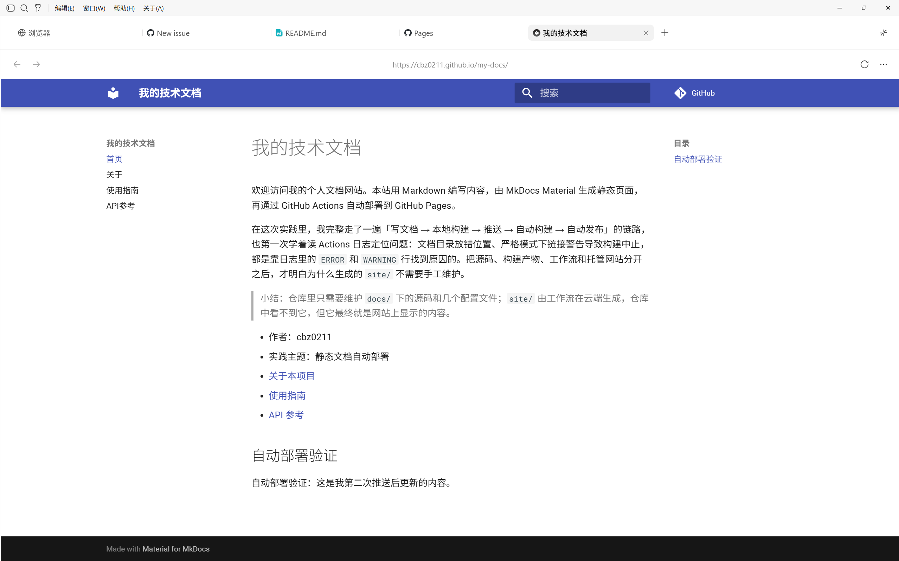

# 实践项目2：个人实验报告

## 1. 基本信息

- GitHub 登录名：cbz0211
- 个人仓库地址：https://github.com/cbz0211/my-docs
- 最终网站地址：https://cbz0211.github.io/my-docs/

## 2. 实践过程与关键截图

### 2.1 仓库创建

我用本人账号 `cbz0211` 新建了仓库 `my-docs`，Owner 选本人、设为 Public、勾选添加 README，并确认默认分支是 `main`。下图是仓库首页，能看到所有者、仓库名和 `Public` 标识，仓库里只有初始的 README。这次是个人作业，所以没有用组织仓库，也没有走 PR 审核，交付只看本人仓库、本人网站和本人在教师仓库提交的那条 Issue。

### 2.2 项目结构与 MkDocs 配置

按说明在仓库根目录建了 `docs/`（四页 Markdown）、`mkdocs.yml`、`requirements.txt`、`.gitignore`、`.github/workflows/deploy.yml`、`README.md` 和 `report/`。下图是本地编辑器里的目录树和打开的配置文件。`docs/` 存我手写的源码；`mkdocs.yml` 的 `nav` 决定导航顺序，路径必须写 `index.md` 而不是 `docs/index.md`；`site/` 是 `mkdocs build` 生成的静态网站，写进 `.gitignore`，不提交也不手工改。四页都补了实质内容：关于页有技术组成表格，API 参考有两段 JSON 代码块，四页之间有互相跳转的链接，首页和使用指南里还写了我自己在这次实践中踩坑和排查的体会。

### 2.3 本地环境准备与构建检查

按说明建虚拟环境、安装 `requirements.txt`，再用 `python -m mkdocs build --strict` 和 `python -m mkdocs serve` 做本地检查。Windows PowerShell 下激活脚本会被执行策略挡住，我查看了 `Activate.ps1` 自带的使用说明（下图），确认它只是把虚拟环境的 Python 放到 PATH 前面，随后改用 Git Bash 的 `source .venv/Scripts/activate`。本机还遇到命令行终端和推送网络的问题（见第 3 节），所以后面的提交改在 GitHub 网页上完成，`--strict` 的最终校验由云端的 Build documentation 步骤承担，日志里没有残留 WARNING。

### 2.4 Pages 与 Actions 设置

在 Settings → Pages → Build and deployment 把 Source 设为 **GitHub Actions**，这样发布来源就是工作流上传的 `site/` artifact，不需要创建 `gh-pages` 分支、不需要申请访问令牌。同时在 Settings → Actions → General 确认仓库允许运行工作流。`deploy.yml` 已在 `deploy` 任务里单独授予 `pages: write` 和 `id-token: write`，所以没有把仓库默认权限改成全局读写，也没有勾选创建/批准 PR 的权限。

下图是设置完成后的 Pages 页面：**Build and deployment → Source 显示为 GitHub Actions**，上方还能看到站点已发布在 `https://cbz0211.github.io/my-docs/`。

另附一张仓库 Actions 权限的核对截图（选中 Allow all actions and reusable workflows）：

### 2.5 Actions 首次构建和部署

四页文档提交到 `main` 后，push 自动触发了工作流。`build` 任务依次完成 Checkout、Setup Python 3.12、Configure Pages、Install dependencies、`mkdocs build --strict`、Upload site artifact；`deploy` 任务通过 `needs: build` 等构建成功后，用 `actions/deploy-pages` 把产物发布到 `github-pages` 环境。首次成功运行是 #15：

https://github.com/cbz0211/my-docs/actions/runs/45045155547

两个任务都是绿色，运行记录里还输出了部署地址 `https://cbz0211.github.io/my-docs/`。下面这张是同一工作流由 push 触发的成功运行记录（#16，见 2.7），可以看到 `build`、`deploy` 两个 job 的状态和 deploy 输出的站点地址。

### 2.6 网站访问与四页导航检查

打开 https://cbz0211.github.io/my-docs/ ，用 Ctrl+F5 排除缓存后逐个检查四个页面：

| 页面 | 地址 | 检查结果 |
| --- | --- | --- |
| 首页 | https://cbz0211.github.io/my-docs/ | 标题、作者信息和三个页面间链接正常 |
| 关于 | https://cbz0211.github.io/my-docs/about/ | 技术组成表格正常渲染 |
| 使用指南 | https://cbz0211.github.io/my-docs/guide/ | 常用命令、实践提示与返回链接正常 |
| API 参考 | https://cbz0211.github.io/my-docs/api/ | 两段 JSON 代码块高亮正常 |

导航里首页、关于、使用指南、API 参考四项都在，页脚显示 Material for MkDocs，资源加载正常。地址必须带仓库路径 `/my-docs/`，以 Settings → Pages 显示的地址为准。下图保留了地址栏，同一屏里还能看到左侧四页导航和首页末尾「自动部署验证」的新增文字。

### 2.7 第二次推送与自动更新验证

在 `docs/index.md` 末尾新增「自动部署验证」一节，写入一句容易辨认的话：「自动部署验证：这是我第二次推送后更新的内容。」然后**单独提交一次**，提交信息为「验证文档修改后自动更新网站」，没有点 Run workflow。这次 push 自动触发了新的运行 #16（41s，Status 为 Success，Triggered via push），刷新网站后新增文字出现在首页，说明「推送文档 → 自动构建 → 自动部署 → 网页更新」整条链路是通的。

- 对应提交链接：https://github.com/cbz0211/my-docs/commit/282fcc223d95e2b5a4c5459ff03796da15817980
- 对应 Actions 运行链接：https://github.com/cbz0211/my-docs/actions/runs/45045599706

下面两张截图分别对应运行记录和网站侧效果：#16 的运行详情页里 `build` 20s、`deploy` 15s 两个任务均成功，右侧还能看到 `282fcc2` 这次提交和 deploy 输出的站点 URL；网站首页则出现了「自动部署验证：这是我第二次推送后更新的内容。」

## 3. 问题与解决

这一节记的都是本次实际遇到的现象和我做的处理。

1. **工作流没有被 GitHub 识别**：一开始 Actions 停在「Get started with GitHub Actions」模板页、地址是 `/actions/new`，说明 `.github/workflows/deploy.yml` 还没进 `main`。补推后 GitHub 立刻识别出工作流，并由 push 触发了第 1 次运行。
2. **`docs_dir` 不存在**：日志出现 `ERROR - Config value 'docs_dir': The path .../docs isn't an existing directory.` 和 `Aborted with a configuration error!`。同一个日志里 Checkout、Setup Python、Install dependencies、Configure Pages 都通过了，说明配置和工作流没问题，只是四页文档没进 `main`。Git 不跟踪空目录，所以 `docs/` 看着建了其实没被提交。
3. **文档目录嵌套导致链接警告**：日志列出 `docs/about.md`、`docs/guide.md` 这类「未纳入 nav 的页面」，说明文件实际在 `docs/docs/` 下；页面里的 `[首页](index.md)` 因此解析到不存在的目标，产生 2 条 WARNING，被 `--strict` 升级为 `Aborted with 2 warnings in strict mode!`。把四页平铺到 `docs/`、`nav` 和页面间链接都改成不带 `docs/` 前缀的文件名后清零。
4. **目录名带前导空格（真正的根因）**：仓库里曾有一个 ` docs`（名字前面多了一个空格）目录，里面还是没替换的模板占位内容。MkDocs 只认 `docs/`，这个目录永远不会被读取，所以前面几次构建一直失败。我在正确位置重建了四页，并用目录页的 Delete directory 清掉了这个错误副本，仓库结构才和要求一致。
5. **本地终端和网络**：终端是 Windows CMD，`ls` 不是内部命令，要用 `dir`；`git push` 报 `Failed to connect to github.com port 443`，是网络层超时而不是账号密码问题。因此后面改用 GitHub 网页直接 Commit changes 完成提交——网页提交同样是 push，会正常触发工作流，作业交付物也不要求本地文件夹长什么样。
6. **核对过、确认没问题的部分**：`mkdocs.yml` 的 `site_url`、`repo_url` 已换成自己的账号；`deploy.yml` 里 `actions/checkout@v7` 等版本、`pages: write` / `id-token: write` 权限、`${{ ... }}` 表达式都保持模板原样；`requirements.txt` 两行依赖范围正确；根 `README.md` 里残留的 `YOUR-USERNAME` 已换成 `cbz0211` 并补上网站链接和报告入口。日志里橙色的 Material / Node.js 20 提示只是运行环境的打印信息，没有计入 MkDocs 的 warning，因此没有加任何环境变量去规避它。

## 4. 原理理解

1. **`docs/` 和 `site/` 各保存什么？为什么不用手工修改 `site/`？**
   `docs/` 是手写的 Markdown 源码，是唯一需要长期维护的内容；`site/` 是 `mkdocs build` 生成的静态网站产物。每次工作流运行都会重新生成并覆盖它，手工改的下次一定被冲掉，所以写进 `.gitignore`，不提交到 `main`。

2. **本次工作流在什么情况下自动运行？**
   push 到 `main` 且改动命中 `paths` 白名单：`docs/**`、`mkdocs.yml`、`requirements.txt`、`.github/workflows/deploy.yml`。另外 `workflow_dispatch` 允许在 Actions 页面手动触发，用于首次重试和排错。

3. **build 与 deploy 两个任务有什么区别？**
   `build` 负责取源码、装 Python 和依赖、`mkdocs build --strict` 生成 `site/`，再用 `upload-pages-artifact` 上传产物，只有 `contents: read` 权限；`deploy` 通过 `needs: build` 等构建成功后才执行，用 `actions/deploy-pages` 把 artifact 发布到 `github-pages` 环境，需要 `pages: write` 和 `id-token: write`。前者产出文件，后者把文件变成可访问的网站。

4. **只修改 `report/README.md` 会触发部署吗？为什么？**
   不会。`report/` 不在 `paths` 白名单里，push 事件被路径过滤掉，工作流根本不启动。这是预期行为，说明报告与网站内容互不干扰，不需要为此改工作流；网站内容没变，也不该重新发布。

5. **本次方案为何无需创建 `gh-pages` 分支？**
   因为用的是 GitHub 官方 Pages Actions：构建产物以 artifact 形式在 job 之间传递，`deploy` 任务直接调用 Pages 部署接口发布，Pages 的 Source 设为 GitHub Actions。分支发布法是另一套方案，两者不能混用；本方案没有把生成的 HTML 推回任何分支。

---

## 附：截图索引

| 步骤 | 文件 | 内容 |
| --- | --- | --- |
| 2.1 | `images/01-repository.png` | 个人公开仓库首页（所有者、仓库名、Public） |
| 2.2 | `images/02-structure.png` | 本地项目目录树与 MkDocs 配置 |
| 2.3 | `images/03-local-env.png` | 本地虚拟环境激活脚本说明 |
| 2.4 | `images/04-pages-setting.png` | Pages 发布来源 Source = GitHub Actions |
| 2.4 | `images/04-actions-permission.png` | 仓库 Actions 权限核对（补充） |
| 2.5 / 2.7 | `images/05-run16-success.png` | push 自动触发的成功运行记录（build、deploy） |
| 2.6 / 2.7 | `images/06-website.png` | 公开网站效果（保留地址栏）与新增文字 |
